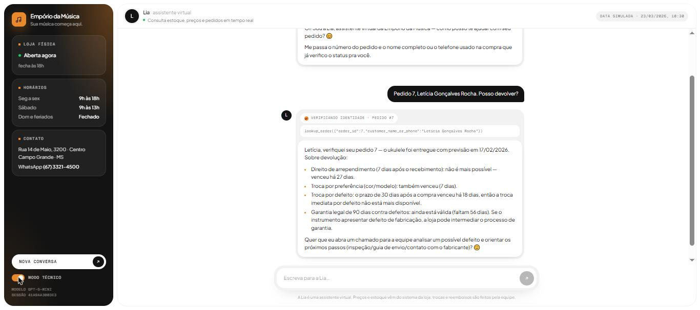

# Empório da Música — Customer Service Agent

A text-based customer service agent for **Empório da Música**, a (fictional) musical
instrument store in Campo Grande/MS. The agent answers customers in Brazilian Portuguese,
looks up live data (catalog, prices, stock, promotions, orders), applies the store's
policy manual (returns, payments, shipping, warranty) and handles out-of-scope requests.

Built for the Artefact **AI Engineer** technical challenge.

```
Cliente: Me arrependi da minha compra, posso devolver meu pedido?
Lia:     ...preciso do número do pedido e do nome completo OU telefone usado na compra.
Cliente: É o pedido 7 / Letícia Gonçalves Rocha
   🔧 lookup_order(order_id=7, customer_name_or_phone="Letícia Gonçalves Rocha")
Lia:     Direito de arrependimento (7 dias após o recebimento): já expirou...
         Garantia legal de 90 dias: ainda válida (faltam 56 dias)...
```

Full conversations: [`examples/`](examples/).



---

## Quickstart

Requirements: Python 3.11+ and an OpenAI API key.

```bash
python -m venv .venv
# Windows: .venv\Scripts\activate    |    macOS/Linux: source .venv/bin/activate
pip install -r requirements.txt
pip install -e .

cp .env.example .env        # then set OPENAI_API_KEY
```

Three interfaces, all on top of the same agent core:

| Interface | Command | Notes |
|---|---|---|
| **Web chat** | `uvicorn emporio.api:app --reload`, then open http://localhost:8000 | Each system lookup appears live as the agent works, the answer is typed out, 👍/👎 feedback is saved, the conversation survives a page reload (session id in the URL), and a "technical mode" shows the raw tool calls. Works on mobile. |
| HTTP API | same server, docs at http://localhost:8000/docs | `POST /chat` (JSON) and `POST /chat/stream` (Server-Sent Events). |
| CLI | `python -m emporio.cli --debug` | `--debug` prints every tool call. `/novo` starts a new conversation. |

API example:

```bash
curl -X POST localhost:8000/chat -H "Content-Type: application/json" \
     -d '{"message": "Quanto custa o Takamine GD20?"}'
# -> {"session_id": "...", "reply": "...", "tool_calls": [{"name": "search_products", ...}]}
# Send the same session_id on the next message to continue the conversation.
```

Other commands:

```bash
pytest                              # 25 tests, no API key needed (OpenAI client is faked)
python -m emporio.audit             # data-quality report on the CSVs
python scripts/run_examples.py      # regenerates examples/ against the real model
python scripts/extract_policies.py  # regenerates data/processed/store_policies.md from the PDF
```

### Configuration (`.env`)

| Variable | Default | Meaning |
|---|---|---|
| `OPENAI_API_KEY` | — | Required. |
| `OPENAI_MODEL` | `gpt-5-mini` | Any chat model with function calling. |
| `OPENAI_REASONING_EFFORT` | `low` | Used for reasoning models (`gpt-5*`, `o*`). |
| `STORE_NOW` | `2026-03-23T10:30` | Simulated "now" (see [Assumptions](#assumptions)). Use `real` for the system clock. |
| `HISTORY_DB` | `var/history.sqlite3` | Conversation history and tickets. |

---

## Architecture

```
                 ┌──────────── CLI ───────── Web chat (web/) ─────── FastAPI ─────────────┐
                 │                                                                        │
                 ▼                                                                        │
          Agent.chat(message, session_id)          (src/emporio/agent.py, ~60-line loop)  │
                 │                                                                        │
   system prompt │  persona + rules + FULL policy manual + interpretation notes + "now"   │
                 ▼                                                                        │
          OpenAI Chat Completions  ── tool calls ──►  StoreTools (pure Python, pandas)    │
                 ▲                                      ├ search_products                 │
                 └──────── JSON results ◄───────────────┤ get_product_details             │
                                                        ├ list_active_promotions          │
                                                        ├ calculate_payment_options       │
                                                        ├ lookup_order  (identity check)  │
                                                        └ open_ticket ──► SQLite          │
          SQLite: conversation history per session_id, support tickets  ◄────────────────┘
```

```
src/emporio/
  data.py      load + clean CSVs, data-quality audit
  tools.py     the 6 tools and their JSON schemas
  prompts.py   system prompt (persona, rules, policy manual, store status)
  agent.py     function-calling loop, history window, loop guard
  store.py     SQLite persistence (history, tickets)
  cli.py       terminal chat
  api.py       FastAPI: /chat, /chat/stream (SSE), history, feedback, tickets; serves web/
web/             web chat: plain HTML/CSS/JS, no build step
data/raw/        original challenge files (untouched)
data/processed/  policy manual extracted to text + interpretation notes
docs/iterations/ outputs of each evaluation round (see Evaluation)
```

---

## Technical decisions

### 1. Approach: function calling with deterministic tools (no RAG, no SQL agent)

The questions fall into two groups that need different treatment:

- **Policies** (address, hours, returns, payments, warranty): stable text, ~11k characters.
- **Data** (prices, stock, promotions, orders): exact values where a wrong number is a real
  problem. The manual itself says that giving prices or stock without checking the system
  "can be considered misleading advertising".

So the agent uses **function calling**. The model decides *which* tool to call and how to
phrase the answer. The tools, written in plain Python, compute every fact: final price with
promotion, Pix price (5% only on non-promotional items, as policy 6.2 requires), maximum
interest-free installments under policy 3.1, shipping fee, days left in each return window,
and whether an order is late.

Alternatives considered:

- **SQL agent (text-to-SQL):** flexible, but the model would write the business rules
  (installment minimums, non-cumulative discounts) into every query. That is harder to test
  and easier to get wrong. Six narrow tools cover the use cases and can be unit-tested.
- **ReAct with free-text reasoning:** native tool calling does the same job with structured
  arguments and fewer parsing failures.

### 2. Policies: the whole manual goes into the system prompt (no vector store)

The manual is 8 pages, about 3k tokens. Putting it in the prompt in full means:

- no retrieval misses (for example a return question that also needs the warranty section);
- no chunking or embedding decisions;
- one less moving part.

The static part of the prompt comes first and the dynamic part (current date/time, open or
closed) goes last, so OpenAI's automatic prompt caching reuses the prefix across turns.
RAG would make sense if the knowledge base grew to many documents (see Limitations).

The PDF is converted once by `scripts/extract_policies.py`. pypdf's default extraction put
every word on its own line for this PDF (it was generated by Google Docs/Skia), so the script
uses layout mode, which keeps lines and tables.

### 3. Model: `gpt-5-mini`, low reasoning effort

- Reliable at function calling and at following multi-rule prompts.
- Cheap: regenerating all five example conversations costs a few cents.
- Fast enough for chat.

Because the tools do the calculations, a larger model adds little. The model is one
environment variable, and the loop works with any OpenAI-compatible endpoint.

### 4. Raw OpenAI SDK instead of a framework

The loop is about 60 lines (`agent.py`): call the model, run the requested tools, return the
results, repeat, with a cap of 6 rounds against loops. Every step is visible and easy to
debug. Tests fake the client, so they run without network access. LangGraph or a similar
framework would be worth it for multi-agent flows, human-in-the-loop interruptions or
durable state machines, none of which this scope needs.

### 5. Privacy (LGPD): order lookup requires order number + name or phone

`lookup_order` returns data only when the order number matches the customer's **phone** (last
8 digits) or **first and last name** (middle names optional). When the check fails, the error
is the same whether or not the order exists, so it cannot be used to discover order numbers.
The response gives only the customer's first name. Internal notes are passed with an
instruction to turn them into a customer-friendly explanation.

### 6. Prompt strategy

- **Persona "Lia":** informal but professional, short chat-style messages. This is the tone
  section 7.1 of the manual asks for.
- **Explicit routing rules:** when to use data, when to use policies, when both.
- **Capabilities list:** the agent informs, calculates and opens tickets. It does **not**
  reserve products, close sales, cancel orders or issue refunds. These come from failures
  seen in evaluation round 1.
- **Escalation:** complaints, delays, returns and purchase intent become a ticket in SQLite,
  but only after the customer explicitly agrees. The ticket protocol and the 24-business-hour
  SLA from the manual are shown to the customer.
- **Out of scope:** accessories (the store sells only instruments, per section 1),
  unrelated topics, and prompt-injection attempts are refused politely, and the conversation
  is brought back to the store.
- **Instructions inside tool results:** some tool results carry a short instruction (for
  example "say *estimated* delivery date"). During evaluation the model followed these more
  reliably than the same rule placed only in the system prompt.

### 7. Web chat: plain HTML/CSS/JS served by FastAPI

The first version used Streamlit. I replaced it because Streamlit re-runs the whole script
on every interaction: the screen flickers, the layout is hard to control, and it cannot show
the agent's progress *while* it works. The new web chat is three static files with no
framework and no build step, served by the same FastAPI app:

- `POST /chat/stream` sends Server-Sent Events. A `tool` event fires before each tool runs,
  through an `on_tool_call` hook in the agent, and a `done` event carries the answer. The
  customer sees "Verificando identidade · pedido #7" instead of a spinner, which makes
  waiting feel shorter and shows *what* the agent checked.
- Markdown is rendered by a small renderer that escapes HTML first, so model output cannot
  inject markup.
- The visual language (type, neutrals, card-in-card surfaces) comes from my agency's site,
  with the store's amber as the only accent.

### 8. Conversation history

The history is stored per `session_id` in SQLite, including tool messages, so follow-ups
like "and how much in installments?" work. A sliding window (last 40 messages, never cut in
the middle of a tool exchange) keeps the prompt bounded. In a WhatsApp integration the
session id would be the customer's phone number.

---

## Data handling

`python -m emporio.audit` loads and cleans the data and lists the inconsistencies it finds.
The agent does not silently "fix" these; the README records them and the tools handle them:

| Finding | How it is handled |
|---|---|
| Product 96 is `active` with stock 0 | Reported as "out of stock right now", with similar in-stock alternatives. |
| Product 136 is `discontinued` but has 13 units | Treated as not for sale; stock is hidden. |
| Product 130 is `coming_soon` but appears in orders 3 and 14 | Shown as "not yet available". The orders are kept as they are. |
| Products 93, 96 and 99 have several (inactive) promotions | Only active promotions are applied; if several were active, the largest discount wins. Ended promotions are reported so the agent can say "that promotion has ended" (policy 7.3). |
| Orders 3 and 20: total differs from current catalog prices | Probably price changes or discounts; the stored total is shown. |
| Orders 9, 16 and 18 break the installment minimums of policy 3.1 | Recorded as a data issue; new quotes always follow the rule. |
| Order 8 is `shipped` and past its estimated delivery | Flagged as late; the agent apologizes and offers a ticket. |

Policy manual conflicts (resolved in [`data/processed/policy_notes.md`](data/processed/policy_notes.md),
which is part of the prompt):

- **Two phone numbers:** section 1.2 gives (67) 3341-4444; section 7 gives WhatsApp
  (67) 3321-4500.
- **Store e-mail:** one occurrence has an accent in the domain (`empóriodamusica`), which is
  almost certainly a typo.
- **Installment minimum:** the payment table says "minimum installment R$ 100", but section
  3.1 sets tiered minimums. The more specific rule (3.1) wins.
- **"More than 300 instruments":** the system has 65 products. The agent never invents
  products.

Other cleaning:

- Specs JSON is parsed.
- Accent-insensitive search with light Portuguese stemming, so "violao" matches "Violões".
- Phone numbers are normalized to digits.
- Money is formatted as `R$ 1.234,56` by the tools, not by the model.

## Assumptions

- **Simulated date.** The orders end in March 2026, so "now" defaults to Monday 2026-03-23
  10:30. Order statuses, delays and return windows only make sense relative to the data; with
  the real clock every order would be months late. Configurable through `STORE_NOW`.
- **Receipt date = estimated delivery date.** There is no actual delivery date in the data.
  The agent says so ("previsão de entrega") and tells the customer the team confirms the exact
  date.
- **"Up to 3x: no minimum (except below R$ 50.00)"** is read as "2x–3x installments must be at
  least R$ 50.00".
- **Return windows** follow the manual literally: withdrawal right is 7 days from receipt,
  defect exchange 30 days from purchase, legal warranty 90 days from receipt. After 30 days a
  defect goes to the manufacturer's warranty, with the store mediating.
- **Store hours:** there is no holiday calendar, so only the standard hours are used and the
  agent mentions that the store closes on holidays.
- **No partner store list exists,** so accessory requests are redirected without naming stores.

---

## Evaluation

Two layers:

1. **Unit tests (25, offline):**
   - every pricing, promotion, installment, identity-check and return-window rule;
   - the agent loop with a scripted fake OpenAI client: tool round-trip, history, tickets,
     unknown tool, loop guard;
   - the API, including the SSE stream, history, feedback and serving the web page.
2. **Scenario runs against the real model:** `scripts/run_examples.py` runs 5 multi-turn
   conversations. Each round's output is kept in [`docs/iterations/`](docs/iterations/), so
   the changes between rounds can be compared.

What each round found and what was changed:

| Round | Problem observed | Fix |
|---|---|---|
| 1 | "Ana Ferreira" unlocked an order of "Ana Carolina Ferreira" with no check on first or last name. | Identity check now requires first **and** last name, or phone (tool + tests). |
| 1 | Opened a ticket without asking the customer. | Explicit confirmation rule in the prompt and in the tool description. |
| 1 | An out-of-stock model was reported as "not found". | `search_products` now returns strong matches that are unavailable, with their status. |
| 1 | Offered actions it cannot perform (reserve a product, send photos). | "Can / cannot do" section in the prompt. |
| 1 | Showed internal `product_id`; repeated greeting and slogan in every message. | Persona rules. |
| 1 | Guessed that a promotion "may have ended". | `get_product_details` now lists ended promotions. |
| 2 | Leaked enum names ("interesse_compra"). Forgot the order number already given. Promised to track the parcel. | Prompt rules. |
| 2 | Said "delivered on 17/02" for an estimated date. | Instruction added to the tool result. |
| 3 | Still offered a restock alert for an out-of-stock item. | Instruction added to the search result. |

Example conversations (final round), each covering a different kind of request:

| File | Scenario |
|---|---|
| [01](examples/01-catalogo-violoes-ate-1000.md) | Catalog search under R$ 1,000, then installments and shipping |
| [02](examples/02-informacoes-e-fora-do-escopo.md) | Address and hours from the policies, accessories (out of catalog), unrelated request |
| [03](examples/03-preco-promocao-e-pix.md) | Price lookup, ended promotion, active promotion plus the non-cumulative Pix rule |
| [04](examples/04-devolucao-arrependimento.md) | **Non-trivial:** verified order lookup, then return and warranty rules applied to the real dates |
| [05](examples/05-pedido-atrasado-e-chamado.md) | **Non-trivial:** failed verification, late delivery, complaint ticket, out-of-stock model with alternatives |

---

## Known limitations and what I would do with more time

- **Evaluation is manual plus unit tests.** Next step: a scenario suite with expected tool
  calls and assertions (e.g. "must call `lookup_order`", "must not state a price without a
  tool call"), plus an LLM-as-judge for tone, run in CI on every prompt change.
- **Brute-force protection:** the identity check has no rate limit. Production would cap
  failed attempts per session or phone number and log them.
- **Search** is token matching with light stemming. It is good enough for 65 products. A
  larger catalog would need hybrid search (BM25 + embeddings) and synonyms ("violão de aço" =
  "folk").
- **Policies in the prompt** do not scale to dozens of documents. At that point: chunked RAG
  with citations, and a policy version shown in each answer.
- **Tickets** are stored only in SQLite. Production would integrate them with the store's
  CRM or helpdesk and notify the team.
- **Data is read-only CSV** loaded at startup. Production would query the store's database
  or ERP, with short caching for stock.
- **Answer text is not token-streamed**: tool progress streams live, but the final answer
  arrives whole and is then typed out on screen. The API has no authentication or
  per-session rate limit.
- **Channel:** the natural deployment is WhatsApp (the manual's main channel). The FastAPI
  `/chat` endpoint is ready to sit behind a WhatsApp webhook, with the phone number as
  `session_id`, which would also give a verified identity.
- **Observability:** tool calls are logged, but there is no tracing (Langfuse or
  OpenTelemetry) and no cost or latency dashboard.

---

## Use of AI coding assistants

I built this project with **Claude Code** (Anthropic's CLI agent, model Claude Opus 5.5) as a
pair programmer. Claude wrote most of the code; I directed the work and made the decisions.
The workflow:

1. **Reading the problem.** Claude read the challenge, the CSVs and the policy PDF, and
   listed the data inconsistencies and policy conflicts (the tables above).
2. **Decisions before code.** Claude proposed options with trade-offs, and I chose:
   - the raw OpenAI SDK instead of a framework;
   - `gpt-5-mini`;
   - three interfaces on one core, and later replacing Streamlit with a custom web chat in
     the style of my agency's site;
   - order verification by order number plus name or phone, for LGPD.
3. **Small, tested steps.** Each layer (data, tools, agent, interfaces) was written,
   unit-tested and committed separately. The commit history shows this.
4. **Evaluation on real conversations.** We ran the five scenarios against the real model,
   read every answer, listed the failures and decided whether each fix belonged in code
   (deterministic: identity check, unavailable models, ended promotions) or in the prompt
   (behavior: confirmation before tickets, no promises it cannot keep). The outputs of
   every round are in `docs/iterations/`.

Where the assistant helped most: speed, exhaustive data auditing and test coverage. Where
human judgment mattered most: deciding how strict privacy should be, what the agent is
allowed to promise a customer, and reading the model's answers critically instead of
stopping at "it runs".
